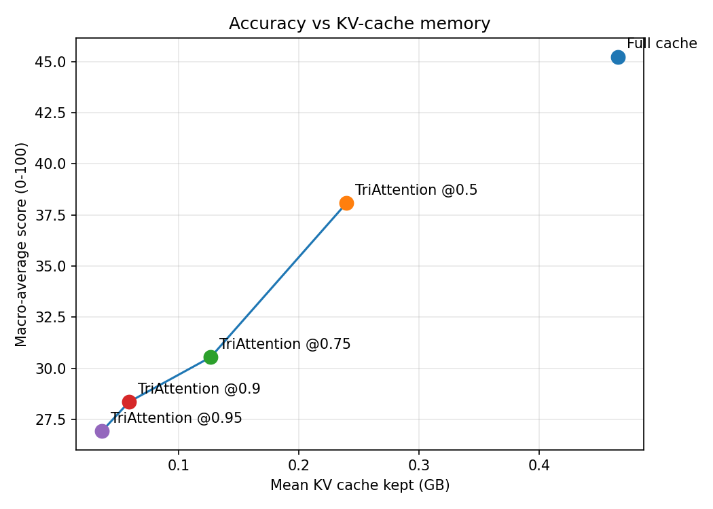

# TriAttention — Observed Flaws

Every point below is measured from our own LongBench runs on meta-llama/Llama-3.1-8B-Instruct, not taken from the paper. Source numbers are in `results_out/per_task_summary.csv` and `results_out/run_summary.csv`.

Baseline (full cache) macro average: **45.24**. Headline TriAttention run: **TriAttention @0.95** (macro **26.94**, mean KV cache **0.036 GB** vs **0.465 GB** full).

## 1. Accuracy cost at the target budget

At TriAttention @0.95, the macro average falls 18.30 points (40.5% relative) below the full cache. This is a large regression.

## 2. Tasks hurt the most

| Task | Category | Full cache | TriAttention @0.95 | Δ |
|---|---|---|---|---|
| hotpotqa | Multi-Doc QA | 66.67 | 16.67 | -50.00 |
| multifieldqa_en | Single-Doc QA | 58.37 | 13.03 | -45.34 |
| 2wikimqa | Multi-Doc QA | 52.68 | 16.13 | -36.55 |
| qasper | Single-Doc QA | 40.88 | 16.16 | -24.72 |
| trec | Few-shot | 60.00 | 36.00 | -24.00 |

## 3. Which capabilities degrade

| Category | Mean Δ vs full cache |
|---|---|
| Multi-Doc QA | -43.27 |
| Single-Doc QA | -35.03 |
| Summarization | -12.35 |
| Few-shot | -6.04 |
| Code | -3.94 |

The **Multi-Doc QA** tasks lose the most, which points to where TriAttention's pre-RoPE importance score discards information this model actually needed.

## 4. Degradation as the budget shrinks

| Run | Compression | Macro avg | Mean KV (GB) |
|---|---|---|---|
| TriAttention @0.5 | 0.5 | 38.08 | 0.240 |
| TriAttention @0.75 | 0.75 | 30.55 | 0.127 |
| TriAttention @0.9 | 0.9 | 28.36 | 0.059 |
| TriAttention @0.95 | 0.95 | 26.94 | 0.036 |

Accuracy drops more than 10 points below full cache once eviction reaches **0.75** (macro 30.55). Below that budget the method is no longer competitive with the full cache on this model.

## 5. Caveat on this measurement

Our `TriAttentionPress` estimates the pre-RoPE query center online from the recent window instead of using the paper's per-model precomputed Q/K statistics (that calibration pipeline ships only inside the vLLM/TensorRT-LLM integration). Part of any regression above may come from this proxy rather than the method itself; it is a flaw of what is runnable in this harness, and is recorded here so the numbers are not over-attributed to the algorithm.
