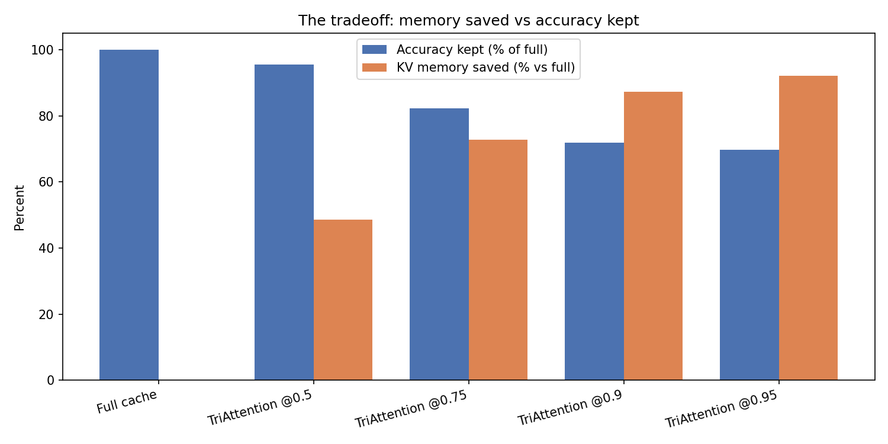
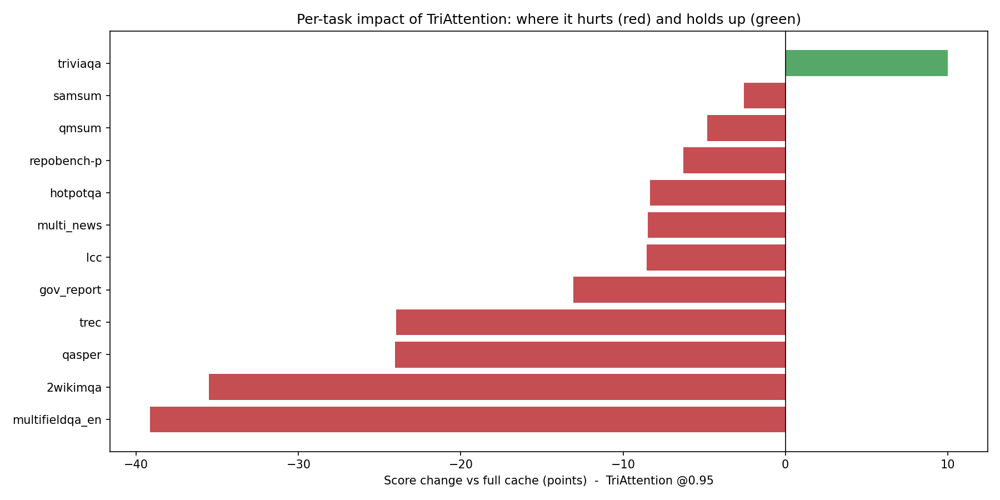

# TriAttention on LongBench

A study of the **TriAttention** KV-cache compression method: how much GPU memory it saves, how much
accuracy it costs, and where it breaks. Evaluated on **LongBench v1** with **Llama-3.1-8B-Instruct**
(bf16) on an RTX 5090.

- Method: TriAttention (Mao et al., ICML 2026, [arXiv:2604.04921](https://arxiv.org/abs/2604.04921);
  repo [WeianMao/triattention](https://github.com/WeianMao/triattention))
- Benchmark: LongBench v1, all 16 English tasks
- Baseline: full KV cache (no compression)

---

## 1. The problem, in one paragraph

When a language model reads a long document, it stores a key and a value for every token it has seen.
This "KV cache" grows with the input and eats GPU memory. **Compression** methods shrink it by throwing
away or shrinking the least useful entries. The question is always the same tradeoff: how much memory
can you save before the answers get worse? This repo measures that tradeoff for TriAttention.

## 2. How TriAttention decides what to keep

Most methods rank cached tokens by the attention they received from a few recent queries. TriAttention
does something different: it scores each key with a **frequency-domain trigonometric series** built from
**precomputed per-head query statistics**. In plain terms, it learns (once, offline) where each
attention head's queries tend to point, then keeps the keys that are expected to attract the most
attention over future positions. It always keeps the most recent tokens and the first few "sink" tokens.

Those offline statistics come from a one-time **calibration** pass (reproduced in
`calibrate_triattention.py`). This repo runs the authors' exact scoring on those stats, so the results
reflect TriAttention as designed.

## 3. The headline tradeoff

Halving the cache costs about 2 points of accuracy. Pushing further trades accuracy for memory down a
smooth curve, reaching a 13x smaller cache at ~31/45 accuracy.


Watching the same tradeoff as an animation (the point walks from full cache down to the smallest cache):


Memory saved versus accuracy kept, side by side:



| Run | Macro avg (0-100) | Mean KV cache (GB) | Accuracy kept | Memory saved |
|---|---|---|---|---|
| Full cache | 45.24 | 0.465 | 100% | 0% |
| TriAttention @0.5 | 43.18 | 0.240 | 95% | 48% |
| TriAttention @0.75 | 37.23 | 0.127 | 82% | 73% |
| TriAttention @0.9 | 32.54 | 0.059 | 72% | 87% |
| TriAttention @0.95 | 31.50 | 0.036 | 70% | 92% |

## 4. Where it breaks (the flaw)

Not all tasks suffer equally. This chart shows, at the most aggressive setting, how much each task
changed versus the full cache. Red = worse, green = better:



The pattern is clear: **question-answering collapses** (multifieldqa_en, 2wikimqa, qasper) while
**code, few-shot, and summarization hold up** — triviaqa even improves.

Per-task scores at every compression level:


The same scores as an animation, one frame per compression level from full cache to the smallest cache:


**Why QA breaks.** QA answers depend on a few specific evidence tokens scattered through a long
document. TriAttention scores a key by expected attention over query *distance and geometry*, not by the
actual question being asked — so isolated evidence tokens that matter for one specific question score low
and get evicted. Tasks with redundant or structured signal (code, few-shot, summarization) survive
because their information is spread across many tokens, so dropping some is cheap. That is the concrete
lever to improve: make the score sensitive to the question/evidence, not only the calibrated query
geometry.

Category-level damage at @0.95 (mean change vs full cache): Single-Doc QA -31.6, Multi-Doc QA -21.9,
Summarization -8.8, Code -7.4, Few-shot -5.5.

## 5. Why these numbers can be trusted

An earlier version of this press *estimated* the query statistics on the fly instead of calibrating
them. That shortcut both **invented flaws that do not exist** (it reported hotpotqa collapsing to 16.7
at @0.5, where the calibrated method actually scores **91.7**) and **exaggerated the real ones**. Running
the authors' calibration fixed this, so the weaknesses above are TriAttention's own, not an artifact of a
shortcut.

| | Query stats | hotpotqa @0.5 | Macro @0.95 | Flaws trustworthy? |
|---|---|---|---|---|
| Earlier version | online estimate | 16.7 (wrong) | 26.9 | no |
| This version | authors' calibration | 91.7 | 31.5 | yes |

## 6. What's in this folder

**Pipeline (run in this order)**

| Step | File | What it does |
|---|---|---|
| 1. Data | `build_dev_data.py` | Builds the LongBench dev set -> `data/processed_longbench/processed_longbench_dev.jsonl` |
| 2. Calibrate | `calibrate_triattention.py` | Reproduces the authors' calibration -> `calibration/llama31_8b_stats.pt` |
| 3. Method | `triattention_press.py` | TriAttention as a kvpress `ScorerPress` (RoPE inversion + trig scoring over the stats) |
| 4. Run + report | `run_all.py` | Runs the baseline + the TriAttention sweep, then the analysis |
| - Analysis | `analyze_results.py` | Builds the CSVs, charts, GIFs, and `RESULTS.md` |
| - Flaws | `write_flaws.py` | Derives `FLAWS.md` from the measured scores |
| - Check | `selftest_triattention.py` | Quick plumbing check on a small open model |

**Outputs** (`results_out/`)
- `per_record.csv` - every record: task, score, latency, KV-cache size
- `per_task_summary.csv` - mean score per task per run
- `run_summary.csv` - macro average, mean KV cache, mean latency per run
- `run_log.txt` - full harness output
- `figures/` - `score_vs_kv_cache.png`, `tradeoff.png`, `per_task_delta.png`, `per_task_scores.png`,
  `macro_average.png`, `accuracy_vs_memory.gif`, `per_task_sweep.gif`
- `longbench/` is kept at the repo level under `results/triattention/longbench/` (per-ratio run files)

**Documents**
- `RESULTS.md` - full results tables and figures
- `FLAWS.md` - the measured flaws and their root cause

## 7. Notes on scope

- Runs cover the LongBench dev prompts under 6K tokens (260 records per run, all 16 tasks). Longer
  prompts exceed the 32 GB GPU during the uncompressed prefill, so the longest documents are not included.
- Calibration uses a 4096-token plain-text pass; the authors note the statistics are domain-agnostic.

## 8. Reproduce

```powershell
huggingface-cli login
C:\Python310\python.exe members/samruddhi/build_dev_data.py
C:\Python310\python.exe members/samruddhi/calibrate_triattention.py --output members/samruddhi/calibration/llama31_8b_stats.pt
C:\Python310\python.exe members/samruddhi/run_all.py --compression-ratios 0.5,0.75,0.9,0.95 --max-prompt-tokens 6000
```
