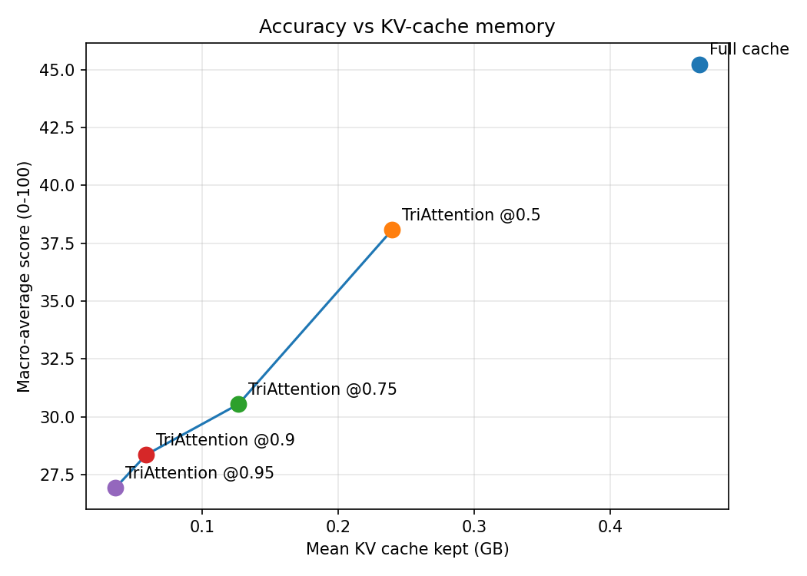
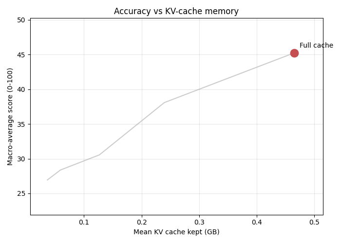
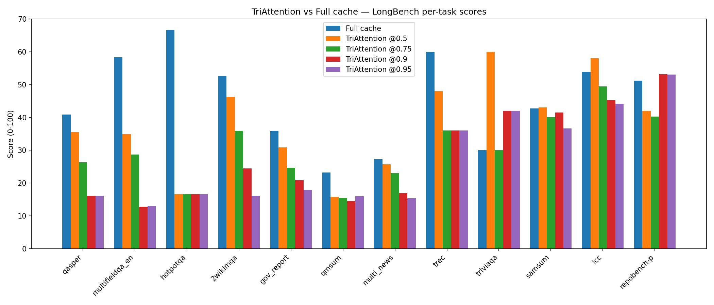
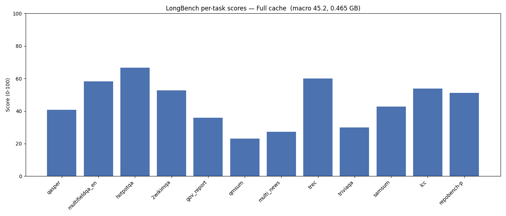
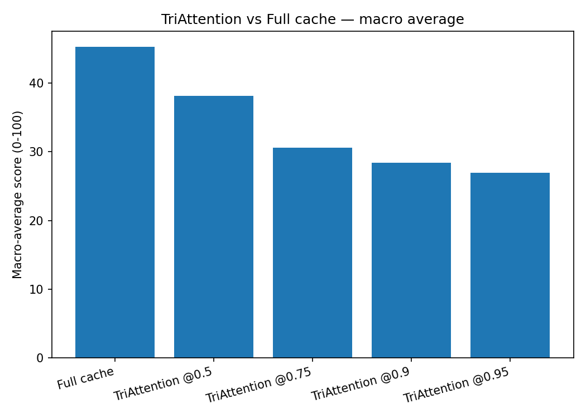

# TriAttention on LongBench

KV-cache compression with **TriAttention** (Mao et al., ICML 2026, [arXiv:2604.04921](https://arxiv.org/abs/2604.04921);
repo [WeianMao/triattention](https://github.com/WeianMao/triattention)), evaluated on **LongBench v1**
with **Llama-3.1-8B-Instruct** (bf16) on an RTX 5090.

TriAttention shrinks the KV cache by scoring each cached key in the **pre-RoPE** space — alignment
with the per-head query center, scaled by the key norm — and keeping the highest-scoring tokens plus
a recent window. It is implemented as a kvpress `ScorerPress` so it runs through the team's shared
evaluation harness against the full-cache baseline on the same prompts and metrics.

## Headline result

As the compression ratio rises, the KV cache shrinks ~13× (0.465 → 0.036 GB) while the macro-average
LongBench score falls from 45.2 to 26.9.





## Per-task behaviour

Scores per task at each compression level. Multi-document QA collapses first; code and few-shot tasks
hold up far better.



The same per-task scores, one frame per compression level from full cache to the most aggressive budget:





## Numbers

| Run | Macro avg | Mean KV cache (GB) | Mean sec/record |
|---|---|---|---|
| Full cache | 45.24 | 0.4654 | 9.02 |
| TriAttention @0.5 | 38.08 | 0.2396 | 8.39 |
| TriAttention @0.75 | 30.55 | 0.1267 | 6.87 |
| TriAttention @0.9 | 28.36 | 0.0589 | 7.43 |
| TriAttention @0.95 | 26.94 | 0.0364 | 6.16 |

Where TriAttention hurts most, vs full cache (at @0.95):

| Task | Category | Full cache | @0.95 | Δ |
|---|---|---|---|---|
| hotpotqa | Multi-Doc QA | 66.67 | 16.67 | -50.00 |
| multifieldqa_en | Single-Doc QA | 58.37 | 13.03 | -45.34 |
| 2wikimqa | Multi-Doc QA | 52.68 | 16.13 | -36.55 |
| qasper | Single-Doc QA | 40.88 | 16.16 | -24.72 |
| trec | Few-shot | 60.00 | 36.00 | -24.00 |

Category-level damage (mean Δ vs full cache): Multi-Doc QA −43.3, Single-Doc QA −35.0,
Summarization −12.4, Few-shot −6.0, Code −3.9.

## Files

**Code**
- `triattention_press.py` — TriAttention as a kvpress `ScorerPress` (pre-RoPE center-aligned scoring,
  attention-sink + recent-window protection, float32 scores)
- `build_dev_data.py` — builds the LongBench dev set → `data/processed_longbench/processed_longbench_dev.jsonl`
- `run_all.py` — runs the full-cache baseline + the TriAttention compression sweep, then the analysis
- `analyze_results.py` — turns run outputs into CSVs, figures, GIFs, and `RESULTS.md`
- `write_flaws.py` — derives `FLAWS.md` from the measured scores
- `selftest_triattention.py` — plumbing check on a small open model

**Outputs** (`results_out/`)
- `per_record.csv` — every record: task, score, latency, KV-cache size
- `per_task_summary.csv` — mean score per task per run
- `run_summary.csv` — macro average, mean KV cache, mean latency per run
- `run_log.txt` — full harness output
- `figures/` — `per_task_scores.png`, `score_vs_kv_cache.png`, `macro_average.png`,
  `per_task_sweep.gif`, `accuracy_vs_memory.gif`

**Documents**
- `RESULTS.md` — full results tables and figures
- `FLAWS.md` — TriAttention's weaknesses, computed from the measured scores

## Setup notes

- Runs cover the LongBench dev prompts under 6K tokens (260 records per run, all 16 tasks); longer
  prompts exceed the 32 GB GPU during the uncompressed prefill.
- `triattention_press.py` estimates the pre-RoPE query center online from the recent window rather
  than the paper's per-model precomputed Q/K statistics, which ship only inside the vLLM/TensorRT-LLM
  integration.

## Reproduce

```powershell
huggingface-cli login
C:\Python310\python.exe members/samruddhi/build_dev_data.py
C:\Python310\python.exe members/samruddhi/run_all.py --compression-ratios 0.5,0.75,0.9,0.95 --max-prompt-tokens 6000
```
