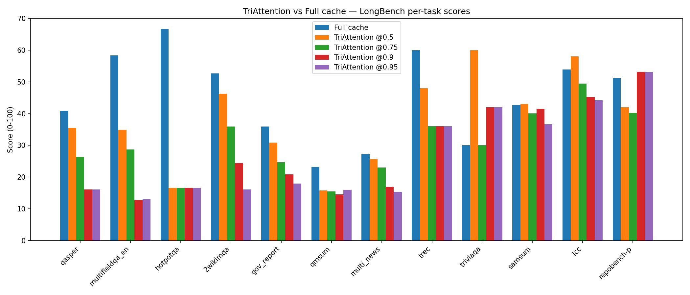
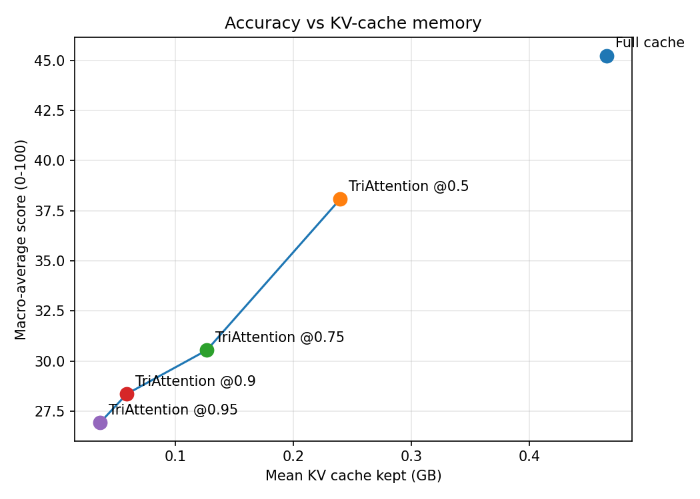
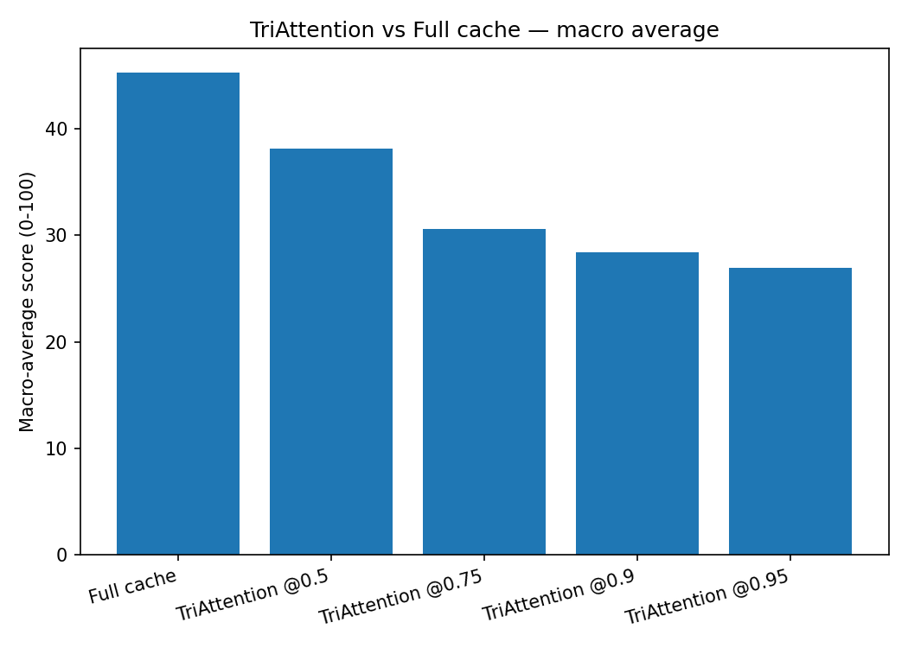

# TriAttention on LongBench — Results

**Method:** TriAttention (Mao et al., ICML 2026, [arXiv:2604.04921](https://arxiv.org/abs/2604.04921); repo [WeianMao/triattention](https://github.com/WeianMao/triattention))  
**Model:** meta-llama/Llama-3.1-8B-Instruct (bf16)  
**Benchmark:** LongBench v1 dev set, 16 tasks (260 records per run, prompts capped at 6K tokens).  
**Baseline:** full cache (no compression). This document covers TriAttention only.

## What TriAttention does

TriAttention scores each cached key in the **pre-RoPE** space (alignment with the per-head query center, scaled by key norm) instead of using the post-RoPE attention of a few recent queries, then keeps the highest-scoring tokens plus a recent window. It is implemented here as a kvpress `ScorerPress` (`members/samruddhi/triattention_press.py`) so it runs through the shared harness with the same fair split and official metrics.

## Runs

| Run | Records | Macro avg | Mean KV cache (GB) | Mean sec/record |
|---|---|---|---|---|
| Full cache | 260 | 45.24 | 0.4654 | 9.02 |
| TriAttention @0.5 | 260 | 38.08 | 0.2396 | 8.39 |
| TriAttention @0.75 | 260 | 30.55 | 0.1267 | 6.87 |
| TriAttention @0.9 | 260 | 28.36 | 0.0589 | 7.43 |
| TriAttention @0.95 | 260 | 26.94 | 0.0364 | 6.16 |

## Per-task scores (0-100)

| Task | Full cache | TriAttention @0.5 | TriAttention @0.75 | TriAttention @0.9 | TriAttention @0.95 |
|---|---|---|---|---|---|
| qasper | 40.88 | 35.53 | 26.36 | 16.12 | 16.16 |
| multifieldqa_en | 58.37 | 34.89 | 28.66 | 12.84 | 13.03 |
| hotpotqa | 66.67 | 16.67 | 16.67 | 16.67 | 16.67 |
| 2wikimqa | 52.68 | 46.30 | 35.89 | 24.46 | 16.13 |
| gov_report | 35.93 | 30.88 | 24.73 | 20.88 | 17.93 |
| qmsum | 23.19 | 15.81 | 15.50 | 14.55 | 16.02 |
| multi_news | 27.28 | 25.67 | 22.98 | 16.93 | 15.41 |
| trec | 60.00 | 48.00 | 36.00 | 36.00 | 36.00 |
| triviaqa | 30.00 | 60.00 | 30.00 | 42.00 | 42.00 |
| samsum | 42.78 | 43.08 | 40.02 | 41.46 | 36.67 |
| lcc | 53.91 | 58.07 | 49.48 | 45.23 | 44.18 |
| repobench-p | 51.19 | 42.06 | 40.27 | 53.20 | 53.04 |
| **macro average** | 45.24 | 38.08 | 30.55 | 28.36 | 26.94 |

## Figures

## Data files

- `results_out/per_record.csv` — every record's task, score, latency, KV-cache size
- `results_out/per_task_summary.csv` — mean score per task per run
- `results_out/run_summary.csv` — macro average, mean KV cache, mean latency per run
- `results_out/run_log.txt` — full stdout/stderr of the harness runs
